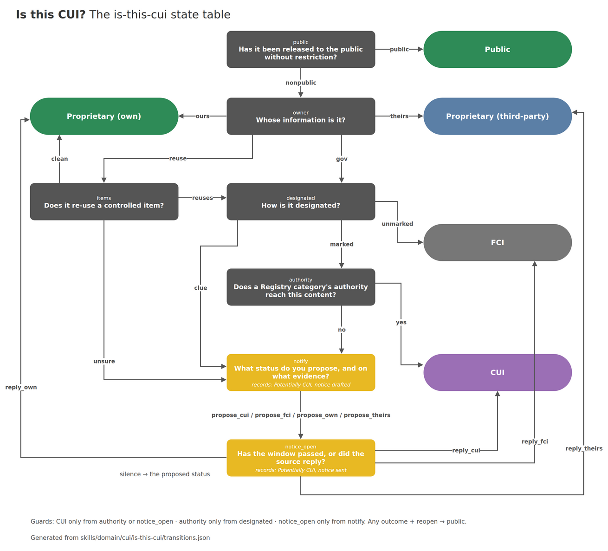

# is-this-cui

Agent skills that help you answer the question nobody can answer: is this CUI?

Your prime sends a drawing with no banner on it and a DFARS 7012 clause in the PO. Nobody says a word about CUI.

So is it CUI?

Ask the prime, and they'll tell you to ask the contracting officer. Ask the contracting officer, and they'll tell you the program office designates CUI, not them. Ask your assessor, and you'll find out deciding CUI isn't their job either.

Nobody's going to answer it for you. So you answer it yourself, on the evidence, and you write down why.

These skills walk an agent through that decision in a fixed order and leave the written record behind.

## Ownership comes before content

Think of a CUI determination like a firewall rule set. The order you process things in decides the answer.

Most people start with what the document says. That's backwards. Who owns it comes first. Here's the definition, 32 CFR 2002.4(h):

> CUI does not include ... information a non-executive branch entity possesses and maintains in its own systems that did not come from, or was not created or possessed by or for, an executive branch agency or an entity acting for an agency.

Translate: if you made it, and it lives on your systems, it's not CUI to you.

After ownership comes designation, then whether a law actually reaches the content. A 7012 clause doesn't designate anything. Neither does a CMMC Level 2 requirement in the PO. The DoD's own FAQ says it plainly: *"The application of a distribution statement does not automatically mean the document is CUI."*

The skill walks that order as a state machine, and it won't let an agent jump to CUI without passing the authority check. You can't skip a step even if you want to.

## Tested against people who actually know

I built this the same way I passed my first CMMC Level 2 assessment: I gave Claude the experts. Then I tested it against 13 real questions from the Cooey COE Discord, graded against the answers the experts there gave.

The first try went badly. It passed 3 of 8 on CUI status. The skill called g-code CUI because it came from a CUI drawing. It called a company's own CAD model CTI because the PDF it was built from was marked.

Every failure turned into a rule. After the fixes, 12 of 13 pass, and the one that still fails is a known gap.

The biggest lesson was export control. CTI only exists where the ITAR or EAR controls the data, and most people skip right past that. My first draft did too. If no export rule catches the data, it can't be CTI, so `export-classification` now settles that question before `is-this-cui` calls anything CTI.



## The skills

| Skill | Answers |
|---|---|
| [`is-this-cui`](skills/is-this-cui/SKILL.md) | Is this document, data field, or data type CUI, FCI, proprietary, or public, for this company, right now? |
| [`export-classification`](skills/export-classification/SKILL.md) | Is this item and its data controlled by the ITAR or the EAR, at which entry, and is the data technical data at all? |
| [`export-control-overlay`](skills/export-control-overlay/SKILL.md) | Who may access export-controlled data, and how is it handled: deemed exports, encryption, travel, providers? |

## How `is-this-cui` decides

The method is a state machine. The agent chooses one event at each state; [`is_this_cui.py`](skills/is-this-cui/is_this_cui.py) keeps the order, refuses an event that does not answer the current state, and prints each step with its reason and citation. The table is [`transitions.json`](skills/is-this-cui/transitions.json):

| State | Question | Event → next |
|---|---|---|
| `public` | Has it been released to the public without restriction? | `public` → **Public**. `nonpublic` → `owner` |
| `owner` | Whose information is it? | `ours` → **Proprietary (own)**. `theirs` → **Proprietary (third-party)**. `reuse` → `items`. `gov` → `designated` |
| `items` | Does it re-use a controlled item? | `clean` → **Proprietary (own)**. `unsure` → `notify`. `reuses` → `designated` |
| `designated` | How is it designated? | `marked` → `authority`. `clue` → `notify`. `unmarked` → **FCI** |
| `authority` | Does a Registry category's authority reach this content? | `yes` → **CUI**. `no` → `notify` |
| `notify` | What status do you propose, and on what evidence? | `propose_cui` → `notice_open`. `propose_fci` → `notice_open`. `propose_own` → `notice_open`. `propose_theirs` → `notice_open` |
| `notice_open` | Has the window passed, or did the source reply? | `silence` → **the proposed status**. `reply_cui` → **CUI**. `reply_fci` → **FCI**. `reply_own` → **Proprietary (own)**. `reply_theirs` → **Proprietary (third-party)** |

```bash
python3 skills/is-this-cui/is_this_cui.py nonpublic reuse clean
```

The order is the rule: whose information it is comes before what it says, and nothing reaches **CUI** without passing `designated` and `authority`. CTI and Export Controlled rest on the ITAR and EAR: information no export rule controls cannot be either.

## How it is tested

- [`scripts/check_is_this_cui.py`](scripts/check_is_this_cui.py) walks every path through the table (108 of them), fails on an open end or a broken guard, and replays [21 worked traces](scripts/is_this_cui_traces.json) and 4 that must be rejected. It runs on every push.
- [`scripts/check_authorities.py`](scripts/check_authorities.py) fails when a skill cites a URL that is not in [`skills/is-this-cui/reference/authorities.md`](skills/is-this-cui/reference/authorities.md). Regulations are linked live at eCFR, not copied, because they change.

## Install

Copy the folders under `skills/` into your agent's skills directory (for Claude Code, `~/.claude/skills/` or a project's `.claude/skills/`), or:

```bash
npx skills@latest add poamslayer/is-this-cui
```

The skills name a few companions (`cui-marking-check`, `cui-re-use-triage`, `gcc-high-decision`, and others). They live in [poamslayer/cmmcslayer](https://github.com/poamslayer/cmmcslayer).

## Not legal advice

These skills help a person reason and keep a record. They do not make a CUI designation or an export classification; the contract, the source, and the design authority or export counsel do.

## License

MIT. Material under `skills/is-this-cui/reference/` reproduces United States Government works, which are in the public domain.
